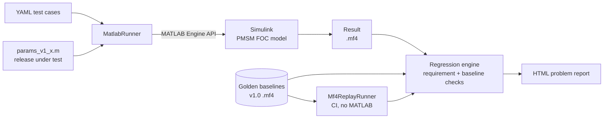

# Automated Regression Testing for a PMSM Field-Oriented Control Model

[](https://github.com/maddy-972/pmsm-regression/actions/workflows/ci.yaml)

A Python framework that validates new releases of a Simulink motor-control model automatically:
it runs defined test cases, records the results as **ASAM MDF (`.mf4`)**, compares them against a
golden baseline, checks requirements, and writes an **HTML problem report** with overlay plots and severity.

> **Headline result:** a patch (v1.1) that improves speed disturbance rejection by 40 % passed every
> original requirement — but the baseline comparison flagged changed current behaviour. The report's
> overlay plots revealed **55 % current overshoot** on a load step. This exposed a gap in the
> specification; after adding the missing requirement, the framework **rejects v1.1 automatically
> (severity: High)**.

---

## What it does



| Layer | Content |
|---|---|
| **Model** | PMSM in dq coordinates, discrete current control (technical optimum, decoupling, voltage limit, anti-windup), speed control (symmetric optimum, current limit, anti-windup) |
| **Test definition** | Test cases as data in YAML: inputs (speed reference, load torque, fault injection) and pass/fail checks |
| **Execution** | Python drives Simulink through the MATLAB Engine API; one MATLAB session runs the whole suite |
| **Data** | All results stored as ASAM MDF 4 (`.mf4`) with units and metadata, via `asammdf` |
| **Evaluation** | Requirement checks (overshoot, settling time, current limit, speed dip, current peak) and baseline checks (max deviation, RMS error) |
| **Reporting** | Self-contained HTML: title, versions, severity, steps to reproduce, expected vs. actual, overlay plots with automatic zoom at the largest deviation |
| **CI** | GitHub Actions runs all unit tests and a replay validation from recorded `.mf4` baselines — no MATLAB needed |

---

## Release validation example: v1.1 vs v1.0

The patch v1.1 changes the speed-controller design factor of the symmetric optimum from *a* = 4 to *a* = 2
(proportional gain ×2, integral gain ×8, phase margin ≈ 60° → ≈ 37°).

| Metric | v1.0 | v1.1 | |
|---|---|---|---|
| Speed dip at 50 Nm load step | 0.160 rad/s | 0.096 rad/s | better |
| Recovery time after load step | 9.9 ms | 2.3 ms | better |
| Speed overshoot after acceleration | 0.11 % | 0.12 % | unchanged |
| **iq peak at load step** | **139 A** | **188 A** | **+35 %** |
| iq undershoot at end of acceleration | ≈ −5 A | ≈ −35 A | current reversal |

**Verdict:** v1.1 rejected. Faster disturbance rejection is bought with much higher current stress;
a larger load step would drive the transient into the 250 A current limit.

**Load step (TC02):** v1.1 current peak 188 A vs 139 A


**End of acceleration (TC01):** v1.1 current reversal to −35 A


### Severity rules
| Severity | Condition |
|---|---|
| **High** | At least one requirement check failed |
| **Medium** | Only baseline checks failed — behaviour changed, review required |
| **None** | All checks passed |

---

## Test cases

| ID | Scenario | Key checks |
|---|---|---|
| TC01 | Speed step 0 → 50 rad/s, no load | Overshoot ≤ 2 %, settling ≤ 0.25 s, iq ≤ 255 A |
| TC02 | Load step 0 → 50 Nm at 50 rad/s | Speed dip ≤ 0.5 rad/s, recovery ≤ 0.2 s, iq peak ≤ 160 A |
| TC03 | Fault injection: +20 A offset on measured iq | Speed dip ≤ 1 rad/s, recovery ≤ 0.2 s, iq_ref vs. baseline |

---

## Model verification

Each part of the model was verified against theory before it was used as a baseline:

| Item | Expected | Measured |
|---|---|---|
| Open-loop plant (10 V on q-axis) | Zero-torque equilibrium at id = ψ/(Lq − Ld) = 87.5 A | 87.5 A, Te ≈ 0 |
| Current loop, 10 A step | Technical optimum: ≈ 4.3 % overshoot, peak after ≈ 0.7 ms | 3.7 %, 0.7 ms |
| Decoupling | id unaffected by iq step | 60 µA on a 10 A step |
| Acceleration at current limit | 50 rad/s / (105 Nm / 0.4 kg m²) ≈ 0.19 s | 0.19 s |
| Determinism | Identical runs give identical results | Baseline deviation exactly 0 |

**Motor and drive:** Rs = 20 mΩ, Ld = 0.4 mH, Lq = 1.2 mH, ψ = 70 mVs, p = 4, J = 0.4 kg m²,
Udc = 300 V, fs = 10 kHz, current limit 250 A.

**Simplifications:** average-value inverter (no PWM switching), ideal sensors, id* = 0 (no MTPA),
viscous friction coefficient assumed. These keep the simulation fast and deterministic, which is
what a regression suite needs.

---

## Repository structure

```
model/        Simulink model, parameter files per release, run_model.m
framework/    Python package
  testcase.py        TestCase: loads YAML, builds input profiles
  runner.py          SimulationRunner (abstract), MatlabRunner, Mf4ReplayRunner
  result.py          Result: signals + metadata, .mf4 read/write
  metrics.py         Overshoot, settling time, dip, max deviation, RMS
  regression.py      Requirement and baseline checks
  report.py          HTML problem report
  validate_release.py   CLI: validate a release against baselines
  record_baselines.py   CLI: record golden baselines (protected against overwrite)
testcases/    YAML test definitions
baselines/    Golden .mf4 results per release
tests/        pytest unit tests (no MATLAB required)
```

---

## How to run

Requirements: MATLAB/Simulink R2026a, Python 3.12.

```powershell
python -m venv .venv
.venv\Scripts\Activate.ps1
pip install -r requirements.txt

pytest -v                                                   # unit tests
python -m framework.validate_release                        # validate v1.0
python -m framework.validate_release --params params_v1_1   # validate the patch
python -m framework.validate_release --replay baselines/v1.0  # without MATLAB
```

The report is written to `reports/report_v<release>_vs_<baseline>.html`.

---

## Design decisions

- **Only `MatlabRunner` depends on MATLAB.** Test cases, results, metrics, checks and reports are pure
  Python, so they are unit-tested and run in CI without a MATLAB licence.
- **Two kinds of checks.** Requirement checks ask "does it meet the spec?"; baseline checks ask "did it
  change?". The v1.1 case shows why both are needed.
- **ASAM MDF as the data format**, the standard for automotive measurement data (e.g. dSPACE ControlDesk),
  so the same evaluation could run on real test-bench or HIL recordings.
- **Self-contained inputs.** `run_model.m` passes all variables through `Simulink.SimulationInput`,
  so results never depend on the MATLAB base workspace.
- **Baselines are protected.** Recording refuses to overwrite existing baselines without `--force`.

## Next steps

- Robustness test cases (inertia ±30 %) to probe phase-margin differences between releases
- Post-processing toolkit for arbitrary `.mf4` test-bench measurements (steady-state detection,
  derived channels, efficiency maps, KPI reports)