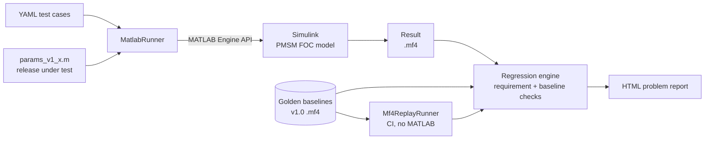
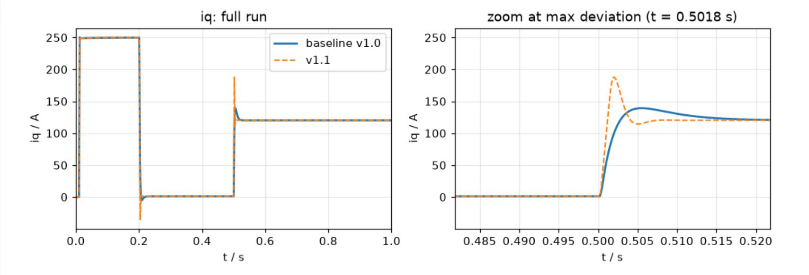
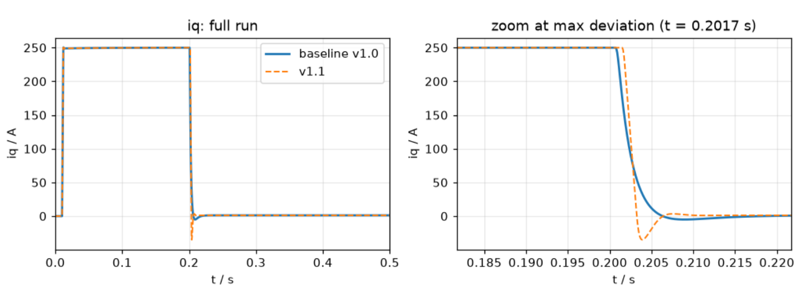
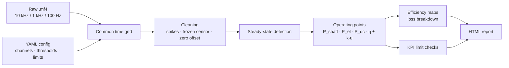
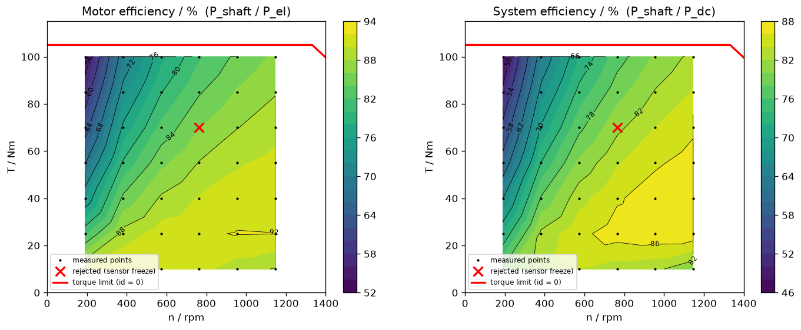
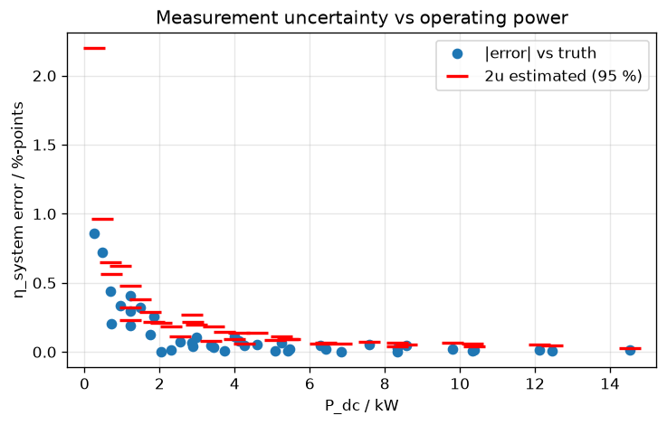

# Motor-Control Validation Toolkit
### Regression testing of a PMSM FOC model · Post-processing of test-bench measurements

[](https://github.com/maddy-972/pmsm-regression/actions/workflows/ci.yaml)

Two Python tools around a permanent-magnet synchronous motor (PMSM) drive, built the way test and
validation teams work: measurement data in **ASAM MDF (`.mf4`)**, test definitions and limits in
**YAML**, results as self-contained **HTML reports**, everything unit-tested and run in **CI**.

| Part | Question it answers | Headline result |
|---|---|---|
| **1. Release regression testing** | *Is the new control-software release safe to ship?* | A patch that improved disturbance rejection by 40 % passed every original requirement, but the baseline comparison exposed **55 % current overshoot**. The missing requirement was added and the patch is now **rejected automatically**. |
| **2. Test-bench post-processing** | *What does this raw measurement say about the motor?* | From a noisy multi-rate recording, the toolkit found **all 3 injected spikes, the frozen sensor and the torque offset**, extracted **41 of 42 operating points** (the 42nd correctly rejected) and produced efficiency maps whose **uncertainty estimate was validated against ground truth**. |

**Example reports:**
[Regression report v1.1 vs v1.0](https://maddy-972.github.io/pmsm-regression/examples/regression_report_v1.1.html) ·
[Test-bench measurement report](https://maddy-972.github.io/pmsm-regression/examples/bench_sweep_report.html)

---

## Part 1: Release regression testing



| Layer | Content |
|---|---|
| **Model** | PMSM in dq coordinates, discrete current control (technical optimum, decoupling, voltage limit, anti-windup), speed control (symmetric optimum, current limit, anti-windup) |
| **Test definition** | YAML: inputs (speed reference, load torque, sensor-fault injection) and pass/fail checks |
| **Execution** | Python drives Simulink through the MATLAB Engine API; one MATLAB session runs the whole suite |
| **Evaluation** | Requirement checks (overshoot, settling time, current limit, speed dip, current peak) and baseline checks (max deviation, RMS error) |
| **Reporting** | Severity, steps to reproduce, expected vs. actual, overlay plots with automatic zoom at the largest deviation |

### Example: patch v1.1 vs v1.0
v1.1 changes the speed-controller design factor of the symmetric optimum from *a* = 4 to *a* = 2
(proportional gain ×2, integral gain ×8, phase margin ≈ 60° → ≈ 37°).

| Metric | v1.0 | v1.1 | |
|---|---|---|---|
| Speed dip at 50 Nm load step | 0.160 rad/s | 0.096 rad/s | better |
| Recovery time after load step | 9.9 ms | 2.3 ms | better |
| **iq peak at load step** | **139 A** | **188 A** | **+35 %** |
| iq undershoot at end of acceleration | ≈ −5 A | ≈ −35 A | current reversal |

**Load step (TC02):** v1.1 current peak 188 A vs 139 A


**End of acceleration (TC01):** v1.1 current reversal to −35 A


**Lesson:** requirement checks ask *"does it meet the spec?"*, baseline checks ask *"did it change?"*.
Here the spec had a gap (no limit on transient current), and only the baseline comparison caught it.

| Severity | Condition |
|---|---|
| **High** | At least one requirement check failed |
| **Medium** | Only baseline checks failed: behaviour changed, review required |
| **None** | All checks passed |

### Model verification
| Item | Expected | Measured |
|---|---|---|
| Open-loop plant (10 V on q-axis) | Zero-torque equilibrium at id = ψ/(Lq − Ld) = 87.5 A | 87.5 A |
| Current loop, 10 A step | Technical optimum: ≈ 4.3 % overshoot, peak after ≈ 0.7 ms | 3.7 %, 0.7 ms |
| Decoupling | id unaffected by iq step | 60 µA on a 10 A step |
| Acceleration at current limit | 50 rad/s ÷ (105 Nm / 0.4 kg m²) ≈ 0.19 s | 0.19 s |
| Determinism | Identical runs give identical results | Baseline deviation exactly 0 |

Motor: Rs = 20 mΩ, Ld = 0.4 mH, Lq = 1.2 mH, ψ = 70 mVs, p = 4, J = 0.4 kg m², Udc = 300 V,
fs = 10 kHz, current limit 250 A. Simplifications: average-value inverter, ideal sensors, id* = 0.

---

## Part 2: Test-bench post-processing



### Test data: a virtual test bench
No real bench data was available, so the Simulink model generates it (`bench/generate_bench_data.py`):
a speed-torque sweep (6 speeds × 7 torques), a loss model (copper from the model, plus synthetic iron and
inverter losses), and bench-style channels at three sample rates (inverter 10 kHz, speed and torque
1 kHz, power analyzer 100 Hz). Then, deliberately: sensor noise, a 0.3 Nm torque offset, three spikes
and a 0.3 s frozen sensor. Setpoints are **not** recorded; the toolkit has to find the operating points
from the measured signals alone.

Because the generator also writes the **ground truth**, every result of the toolkit can be checked.

### Results vs. ground truth
| Item | Detected | Truth |
|---|---|---|
| Torque spikes | 0.117, 22.596, 37.231 s | 0.117, 22.596, 37.231 s |
| Frozen sensor | 45.000–45.299 s | 45.000–45.299 s |
| Torque zero offset | 0.308 ± 0.004 Nm | 0.300 Nm |
| Operating points | 41 of 42; the one containing the frozen segment rejected | 42 |
| Max speed / torque error | 0.006 rad/s / 0.023 Nm | |



Copper loss (~1.7 kW at 100 Nm) dominates at high torque, so efficiency drops to ≈ 54 % at
191 rpm / 100 Nm; the efficiency island of ≈ 92 % lies at high speed and moderate torque. The red line is
the torque limit for id = 0 (current limit, then voltage limit). With a limit of η_motor ≥ 85 % above
900 rpm and 50 Nm, the report returns **FAIL** (minimum 84.5 % at 955 rpm / 100 Nm).

### Uncertainty, validated
Each operating point carries an expanded uncertainty (95 %): block standard error of the mean (Type A,
Student-t factor k = 2.26 for 9 degrees of freedom) combined with the uncertainty of the torque
zero-offset estimate.



| Quantity | Errors within k·u | Expected |
|---|---|---|
| η_system | 95 % | 95 % |
| η_motor | 90 % | 95 % |

**Known limitation:** the η_motor shortfall comes from an 8 mNm residual bias in the standstill offset
estimate (2σ). This is a systematic effect that a statistical budget cannot capture; on a real bench the
torque-flange calibration certificate (Type B) covers it. Two fixes were tried and kept (excluding
acceleration and braking samples from the offset estimate, adding the offset uncertainty); widening the
error bars until the number looks right was not.

### Config-driven
The code is generic; everything specific to a test lives in YAML. Channel names in the file are mapped
to internal names, so a different bench only needs a different config:

```yaml
measurement:
  file: bench/data/bench_sweep_raw.mf4
  master: T_shaft
  channels: {n_rpm: n_rpm, T_shaft: T_shaft, Udc: Udc, Idc: Idc, id: id, iq: iq, ud: ud, uq: uq}
cleaning:
  spikes: {channels: [T_shaft], k: 8}
  frozen: {channels: [T_shaft], min_len: 50}
  offset: {channel: T_shaft, n_max_rpm: 5}
limits:
  - {name: eta_motor_high_speed, kpi: eta_motor, stat: min,
     where: {n_rpm: [900, .inf], torque_Nm: [50, .inf]}, min: 0.85}
  - {name: frozen_sensor_time, quality: frozen_s, max: 0.5, unit: s}
```

---

## Repository structure
```
model/          Simulink model, parameter files per release, run_model.m
framework/      Part 1: regression testing
  testcase.py, runner.py, result.py     test cases (YAML), MATLAB / replay runners, MF4 results
  metrics.py, regression.py, report.py  metrics, checks, HTML problem report
  validate_release.py, record_baselines.py
testcases/      YAML test definitions
baselines/      golden .mf4 results
bench/          virtual test bench (data generator)
postproc/       Part 2: post-processing
  io.py, clean.py, steady.py, maps.py   loading, cleaning, steady states, maps
  pipeline.py, kpi.py, html_report.py   config-driven pipeline, limit checks, HTML
  report.py                             CLI
  configs/                              YAML configurations
tests/          pytest unit tests (no MATLAB required)
docs/           example reports and figures
```

## How to run
Requirements: MATLAB/Simulink R2026a (Part 1 and data generation only), Python 3.12.

```powershell
python -m venv .venv
.venv\Scripts\Activate.ps1
pip install -r requirements.txt
pytest -v

# Part 1
python -m framework.validate_release                          # validate v1.0
python -m framework.validate_release --params params_v1_1     # validate the patch
python -m framework.validate_release --replay baselines/v1.0  # without MATLAB

# Part 2
python -m bench.generate_bench_data                           # create the bench measurement
python -m postproc.report postproc/configs/bench_sweep.yaml   # analyse it
```

## Design decisions
- **Only one class depends on MATLAB** (`MatlabRunner`). Everything else is pure Python, so it is
  unit-tested and runs in CI without a MATLAB licence.
- **ASAM MDF throughout**, the standard format of automotive measurement and calibration tools,
  so the same evaluation applies to real test-bench or HIL recordings.
- **Data quality is reported, not hidden.** Bad data is blanked and the affected operating point is
  rejected and listed, instead of being averaged.
- **Every algorithm was checked against something known:** metrics against analytical step responses,
  the model against hand calculations, the post-processing against injected ground truth.
- **Baselines are protected** against accidental overwrite.